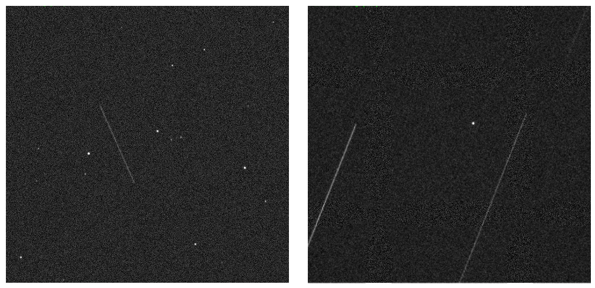

Welcome to SImSiT's documentation!
==================================

SImSiT (Satellite Image Simulation Toolkit) is a Python package for generating
synthetic telescope images of stars and satellites. It provides configurable
models for instrument response, world coordinate systems, tracking behavior,
observation cadence, and catalog-based source generation.

SImSiT can be used to simulate a variety of observing scenarios, including
sidereal tracking and target tracking, and to generate image products and
reference data for testing analysis workflows.

   Example simulated output from SImSiT. Left: an image generated with sidereal
   tracking, where the fast-moving satellite appears as a streak. Right: an
   image generated with target tracking, where the stars appear streaked and
   the tracked satellite appears nearly point-like.

.. note:: Finding your way around

   A good place to start is with the installation guide and the getting started
   page.

   If you are developing on SImSiT, see the contributing and developer guides.

   If you encounter an issue or need support, please open a
   `GitHub issue <https://github.com/LLNL/simsit/issues>`_.

Contents
--------

.. toctree::
   :titlesonly:
   :maxdepth: 1

   installation
   gettingstarted
   background
   acknowledgements
   contributing
   developer
   changelog
   references
   scientific_validation
   api

Indices and tables
==================

* :ref:`genindex`
* :ref:`modindex`
* :ref:`search`
